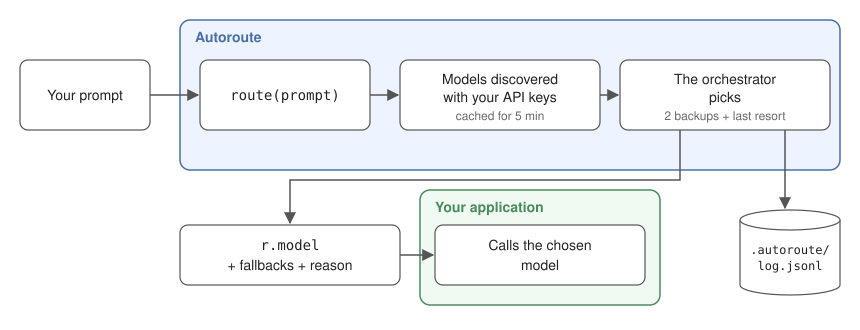

# Autoroute

🇫🇷 [Français](https://github.com/SethLawson07/autoroute/blob/main/README.md) · 🇬🇧 **English**

**Bring your API keys. Autoroute picks the model.**

You give Autoroute your prompt, that is, the task to perform. It picks the most suitable model among those **your API keys can access**, returns its name and tells you why. You don't need to know which model to use for what.

```python
from langchain.chat_models import init_chat_model
from autoroute import route

prompt = "Write a Python function that parses a CSV file"
r = route(prompt)
model = init_chat_model(r.model)  # e.g. "anthropic:claude-sonnet-…"
```

- **OpenAI, Anthropic, Gemini, Mistral**: models are discovered with your keys, no list to maintain.
- **Your keys stay with you**: no Autoroute server, direct calls to the providers.
- **Sovereign mode**: with `AUTOROUTE_MODE=sovereign`, only Mistral models (France) are used. See [Modes](#modes).
- **The right price for each task**: a lightweight model for simple tasks, a powerful one only when needed. Measuring the savings is not available yet.
- **Every choice is explained**: the decision and its reason are written to a JSONL log.
- **Never crashes your application**: backup orchestrators, then fallback to a discovered model.

Autoroute does **not** call the model: it returns an object whose `r.model` is the model name, in LangChain format (default) or in the native format of the official SDKs, LlamaIndex and Haystack (`route(prompt, to="native")`).

## How it works



1. **Discovery**: Autoroute queries the model-listing API of every provider whose key is set, and keeps the chat models. There is no model list to maintain. The list is kept in memory for 5 minutes: later `route()` calls don't fetch it again.
2. **Routing**: an **orchestrator**, a lightweight model picked automatically among your models to keep routing fast and cheap (or the one you choose in `.autoroute/config.yaml`), receives your prompt and that list. It returns the most suitable model, up to 2 fallbacks, and the reason for its choice. Its answer is restricted to the discovered models.
3. **Logging**: every decision is written to a JSONL log.

## Installation

```bash
pip install autoroute-ai
```

- With uv: `uv add autoroute-ai`
- Development version: `pip install git+https://github.com/SethLawson07/autoroute`

Python 3.10 or later. LangChain and the OpenAI, Anthropic, Google GenAI and Mistral integrations are installed with Autoroute.

Already installed in your project? Recent versions are kept: Autoroute only requires minimum versions (LangChain 1.0 or later). If your project is still on LangChain 0.x, pip will upgrade it, which may change how your existing code behaves. To avoid any conflict, install Autoroute in a virtual environment.

## Quickstart

```powershell
autoroute init                   # creates .env.example (and the optional .autoroute/config.yaml)
copy .env.example .env           # macOS / Linux: cp .env.example .env
# fill in at least one API key in .env (OpenAI, Anthropic, Gemini or Mistral)
autoroute models                 # shows where each key comes from, and the discovered models
autoroute route "Design the architecture of a secure payment API, with refund handling"
autoroute ui                     # the decision log in your browser
```

Sample output:

```
Model:     anthropic:claude-opus-5-5
Fallbacks: openai:gpt-5, google_genai:gemini-3.1-pro-preview
Reason:    Complex architecture design with security requirements: a powerful model is needed.
Routed:    yes
Id:        ae3a775c9f1e4b0d8c2a6e1f3b5d7a90
```

In your code:

```python
from autoroute import route

r = route("Write a Python function that parses a CSV file")
print(r.model, r.reason)
```

To use it with LangChain (chat model, agent, fallbacks), see [Usage with LangChain](#usage-with-langchain).

## Configuration

### `.env`: your API keys

One key per provider. Leave a key empty if you don't use that provider: it is skipped.

```
OPENAI_API_KEY=       # OpenAI Platform
ANTHROPIC_API_KEY=    # Anthropic Console
GOOGLE_API_KEY=       # Google AI Studio (Gemini)
MISTRAL_API_KEY=      # Mistral La Plateforme
```

System environment variables take precedence over `.env`. `autoroute models` shows the source of each key (`system`, `.env`, `system (.env ignored)` or `missing`), never its value.

**Your keys stay with you.** Autoroute has no server: we never have access to your keys or your prompts. Your keys are only used to call each provider's API directly (model list, orchestrator). They are never written to the log. Your prompt is only sent to the orchestrators' providers: the main one, then a backup orchestrator if it doesn't answer. They always belong to the active mode (in `sovereign` mode: Mistral only).

### Modes

`AUTOROUTE_MODE` selects which providers Autoroute may route to. To change mode, add for example `AUTOROUTE_MODE=sovereign` to `.env` (or set it as an environment variable).

| Mode | Providers | Key needed |
|---|---|---|
| `all` (default) | OpenAI, Anthropic, Gemini, Mistral | at least one |
| `openai` | OpenAI | `OPENAI_API_KEY` |
| `anthropic` | Anthropic | `ANTHROPIC_API_KEY` |
| `gemini` | Gemini | `GOOGLE_API_KEY` |
| `sovereign` | Mistral only (French provider), all models available to your key | `MISTRAL_API_KEY` |

The mode also applies to the orchestrator: it always belongs to a provider of the active mode.

### The orchestrator: picked automatically

The orchestrator is the model that does the routing. You don't pick it, and no model name is hard-coded: Autoroute takes it from the list of discovered models.

- It looks for a lightweight model, to keep routing fast and cheap, recognized by its family (`haiku`, `mini`, `flash`, `small`), and takes the newest. When a provider releases a new version, it is used without updating Autoroute.
- It keeps up to 2 backup orchestrators, from other providers when possible, tried if the first one doesn't answer.
- Only the mode's providers are used, so `sovereign` mode never sends your prompt to a non-Mistral model.

`autoroute models` shows the chosen orchestrator and the backups.

**Routing never crashes your application.** If no orchestrator answers (outage, quota, more than 20 s), Autoroute still returns a discovered model (other than the failed orchestrators, when possible), with `r.routed == False`, and logs the error. It only raises when it has no model to offer (no valid key). An orchestrator that names a model that doesn't exist counts as a failure: the next orchestrator takes over. Every orchestrator failure, even one caught by a backup orchestrator, is reported as a `WARNING` on the standard `autoroute` logger (`logging` module): printed to stderr by default, it reaches your application's monitoring if you configure `logging`.

### `.autoroute/config.yaml` (optional): choosing your orchestrator

Everything works without this file. It only replaces the automatic choice, mode by mode:

```yaml
orchestrators:
  all: anthropic:claude-haiku-5-5
```

The chosen orchestrator goes first, the automatic ones stay as backups. It must belong to a provider of the mode. If it is unreachable (other provider, retired model, missing key) or the file is unreadable, Autoroute prints a warning and uses the automatic choice. `autoroute init -o provider:name` writes it for the active mode.

The choice of orchestrator matters: it only sees model **names**, so its choice depends on what it knows about them. A recent orchestrator knows recent models better.

### The `.autoroute/` folder

Autoroute keeps its files in `.autoroute/`, at the root of your project (the folder you run your application from):

```
my-project/
├── .env                 # your API keys
└── .autoroute/
    ├── config.yaml      # optional: can be committed
    ├── log.jsonl        # decision log
    └── .gitignore       # created automatically: excludes *.jsonl
```

The log contains the text of your tasks: the `.gitignore` created by Autoroute keeps it out of git.

### Environment variables

They can also be set in `.env`.

| Variable | Purpose | Default |
|---|---|---|
| `AUTOROUTE_MODE` | Routing mode | `all` |
| `AUTOROUTE_CONFIG` | Path to the config file | `.autoroute/config.yaml` |
| `AUTOROUTE_LOG` | Path to the log file, or `stdout` / `off` (see [Observability](#observability)) | `.autoroute/log.jsonl` |

## Usage with LangChain

```python
from autoroute import route

r = route("Write a Python function that parses a CSV file")
r.model      # "anthropic:claude-sonnet-5-5"
r.fallbacks  # ["openai:gpt-5.5", "google_genai:gemini-3.8-pro"]  (0 to 2, without r.model)
r.provider   # "anthropic": provider of r.model (openai, anthropic, google, mistral)
r.providers  # ["anthropic", "openai", "google"]: providers of [r.model, *r.fallbacks], in order
r.reason     # why this model, in the language of the task
r.routed     # True: chosen for your task. False: default model (no orchestrator answered)
r.id         # ID of the decision in the log
```

### Chat model, with fallbacks

For a question and an answer: the model receives your prompt and answers in one go.
If the chosen model fails (rate limit, outage, no access…), LangChain moves on to the next fallback.

```python
from langchain.chat_models import init_chat_model
from autoroute import route

prompt = "Write a Python function that parses a CSV file"
r = route(prompt)

model = init_chat_model(r.model).with_fallbacks([init_chat_model(m) for m in r.fallbacks])
print(model.invoke(prompt).content)
```

### Agent, with fallbacks

For a multi-step task: the agent uses tools (files, web, APIs…) until it can answer. If the model fails along the way, the agent moves on to the next fallback.

```python
from langchain.agents import create_agent
from langchain.agents.middleware import ModelFallbackMiddleware
from autoroute import route

prompt = "Analyze this log file and summarize the errors"
r = route(prompt)

agent = create_agent(
    model=r.model,
    tools=[...],
    middleware=[ModelFallbackMiddleware(*r.fallbacks)] if r.fallbacks else [],
)
agent.invoke({"messages": [{"role": "user", "content": prompt}]})
```

Any tool in the LangChain ecosystem that accepts a chat model (LangGraph, Deep Agents…) works the same way: pass it `init_chat_model(r.model)`.

### Examples

See [`examples/`](https://github.com/SethLawson07/autoroute/tree/main/examples):

| File | Shows |
|---|---|
| `01_chat_model.py` | Chat model with fallbacks |
| `02_agent.py` | Agent with `ModelFallbackMiddleware` |
| `03_modes.py` | Routing of simple and complex tasks |
| `04_fallback.py` | A real fallback, with a primary model forced to fail |

### Other frameworks: `to="native"`

The `to` parameter picks the format of `r.model` and `r.fallbacks`:

| `to=` | `r.model` | For |
|---|---|---|
| `"langchain"` (default) | `"google_genai:gemini-3.8-flash"` | LangChain, LangGraph, Deep Agents |
| `"native"` | `"gemini-3.8-flash"` | Official SDKs (OpenAI, Anthropic, Google, Mistral), LlamaIndex, Haystack |

With `"native"`, `r.model` is the official model name, and `r.provider` tells you which SDK or class to use (`r.providers` does the same for each fallback):

```python
r = route(prompt, to="native")   # e.g. r.model = "claude-haiku-5-5", r.provider = "anthropic"

# Official SDK
import anthropic
anthropic.Anthropic().messages.create(model=r.model, max_tokens=1024, messages=[{"role": "user", "content": prompt}])

# LlamaIndex
from llama_index.llms.anthropic import Anthropic
llm = Anthropic(model=r.model)

# Haystack
from haystack_integrations.components.generators.anthropic import AnthropicChatGenerator
generator = AnthropicChatGenerator(model=r.model)
```

To handle every provider, map each one to its class, for example `{"anthropic": Anthropic, "openai": OpenAI, ...}[r.provider](model=r.model)`. The SDK, the class and the fallbacks are up to you: Autoroute never calls the model. An unknown `to` value raises a `ValueError`.

More formats (LiteLLM, Pydantic AI) are planned.

## Observability

The log lets you understand every choice. It stays on your machine.

Everything is appended to `.autoroute/log.jsonl`, one JSON object per line. The `schema_version` field changes if the log format evolves: useful if you read it with a script.

If the log cannot be written (read-only folder, for example in a container), `route()` still works: the decision is not recorded and a `WARNING` from the `autoroute` logger reports it once. Then pick a writable folder with `AUTOROUTE_LOG`.

In production, `AUTOROUTE_LOG` also accepts two values:

| `AUTOROUTE_LOG=` | Effect |
|---|---|
| `stdout` | One JSON line per decision on standard output: your platform (Docker, Kubernetes, Cloud Run…) collects it with your other logs. These lines contain your prompts. |
| `off` | No decision is recorded. |

In both cases, `autoroute ui` needs a file: `autoroute ui --log file.jsonl`.

On Windows PowerShell 5.1, read it with `Get-Content .autoroute/log.jsonl -Encoding UTF8`, otherwise accents are garbled.

### `autoroute ui`: the log in your browser

```powershell
autoroute ui                     # opens http://127.0.0.1:8765
autoroute ui --log prod.jsonl    # another file, for example a log copied from your production
autoroute ui --port 9000         # another port
```

The page shows a summary (rate of unrouted decisions and invalid choices, mean latency, most chosen models and orchestrators), a table of the last 1,000 decisions with search and filters, and the details of each decision (task, reason, candidates, errors). The "Refresh" button rereads the log without restarting the command. `Ctrl+C` stops the server.

The server only listens on your machine (`127.0.0.1`), read-only, and the page loads no external resources. Never expose it on a network: the log contains your prompts. For a remote server, copy the file and run `autoroute ui --log` locally, or use an SSH tunnel (`ssh -L 8765:127.0.0.1:8765 server`).

### `decision`: written on every routing call

```json
{"schema_version": "3", "timestamp": "2026-11-07T12:48:25+00:00", "event": "decision", "decision_id": "ae3a775c…", "task": "Write a Python function that parses a CSV file", "orchestrator": "anthropic:claude-haiku-5-5", "model": "openai:gpt-5-mini", "candidates": ["openai:gpt-5-mini", "google_genai:gemini-3.8-flash", "anthropic:claude-haiku-5-5"], "reason": "...", "invalid_choice": false, "routing_failed": false, "latency_ms": 2965, "mode": "all", "error": null}
```

| Field | Meaning |
|---|---|
| `decision_id` | ID of the decision (`r.id`) |
| `task` | Your prompt |
| `orchestrator` | The model that made the choice |
| `model` | Chosen model |
| `candidates` | The chosen model, then up to 2 fallbacks, in order |
| `reason` | Why the orchestrator chose it |
| `invalid_choice` | `true` if an orchestrator named a model that doesn't exist: the next orchestrator took over |
| `routing_failed` | `true` if no orchestrator answered (`r.routed == False`): the returned model was not chosen for your task |
| `latency_ms` | Routing time |
| `mode` | Mode used |
| `error` | Errors from orchestrators that didn't answer or named a model that doesn't exist (including when a backup orchestrator took over) |

> **The log contains your prompts.** It is ignored by git. Do not share it if your prompts are sensitive.

## Known limitations

- The orchestrator is recognized by its family name (`haiku`, `mini`, `flash`, `small`): if a provider changes its naming, Autoroute takes another discovered model, possibly less suited to routing.
- The orchestrator only sees model **names**, not their capabilities or prices: it can misjudge a model it doesn't know.
- Routing is not deterministic: the same prompt can get different (reasonable) choices.
- Routing adds one paid call and a few seconds (about 1 to 7 s depending on the orchestrator, in our tests).
- Each orchestrator has 20 s to answer, with at most one retry: beyond that, the backup orchestrator takes over. In the worst case (all 3 orchestrators too slow), routing can therefore take about 2 minutes before falling back to a discovered model.
- Discovered models are kept in memory for 5 minutes: a provider's new model can take up to 5 minutes to show up. A change of API key, `AUTOROUTE_MODE` or `.autoroute/config.yaml` takes effect immediately.
- A provider may list a model your key cannot call: if it is chosen, the fallbacks take over.
- One choice per prompt: no re-routing at each step of an agent.
- No check of the chosen model's capabilities (tool calling, vision).
- No cost calculation or savings measurement yet.
- The orchestrator's reason follows the language of your prompt.
- LangChain is the reference integration: the examples and automatic fallbacks are written for it. With `to="native"`, picking the SDK and handling fallbacks are up to you. LangChain is still installed with Autoroute, which uses it to query the orchestrator.

## Security

To report a security vulnerability, do not open a public issue: use [GitHub's private reporting](https://github.com/SethLawson07/autoroute/security/advisories/new). See [SECURITY.md](https://github.com/SethLawson07/autoroute/blob/main/SECURITY.md).

## License

[MIT](https://github.com/SethLawson07/autoroute/blob/main/LICENSE) © 2026 Laté Seth Lawson-Hetchely · [sethlawson.fr](https://sethlawson.fr/)
