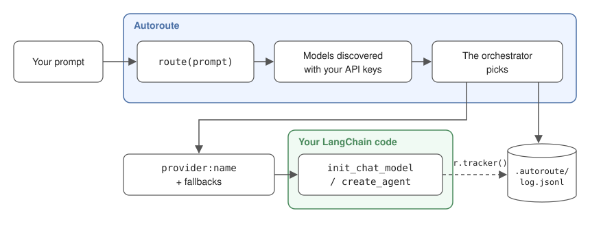

# Autoroute

🇫🇷 [Français](README.md) · 🇬🇧 **English**

**Bring your API keys. Autoroute picks the model.**

You give Autoroute your prompt, that is, the task to perform. It picks the most suitable model among those **your API keys can access**, returns its name and tells you why. You don't need to know which model to use for what.

```python
from langchain.chat_models import init_chat_model
from autoroute import route

prompt = "Write a Python function that parses a CSV file"
model = init_chat_model(route(prompt))  # e.g. "anthropic:claude-sonnet-…"
```

- **OpenAI, Anthropic, Gemini, Mistral**: models are discovered with your keys, no list to maintain.
- **Your keys stay with you**: no Autoroute server, direct calls to the providers.
- **Sovereign mode**: with `AUTOROUTE_MODE=sovereign`, only Mistral models (France) are used. See [Modes](#modes).
- **Every choice is explained**: the decision and its reason are written to a JSONL log.
- **Never crashes your application**: backup orchestrators, then fallback to a discovered model.

Autoroute does **not** call the model: it returns a `provider:name` string that you pass to LangChain or to another tool.

## How it works



1. **Discovery**: Autoroute queries the model-listing API of every provider whose key is set, and keeps the chat models. There is no model list to maintain.
2. **Routing**: an **orchestrator**, a small fast model picked automatically among your models (or the one you choose in `.autoroute/config.yaml`), receives your prompt and that list. It returns the most suitable model, up to 2 fallbacks, and the reason for its choice. Its answer is restricted to the discovered models.
3. **Logging**: every decision is written to a JSONL log. If you pass `r.tracker()` to LangChain, the log also shows which model actually answered (and any fallbacks).

## Installation

```bash
pip install autoroute
```

- With uv: `uv add autoroute`
- Development version: `pip install git+https://github.com/SethLawson07/autoroute`

Python 3.10 or later. LangChain and the OpenAI, Anthropic, Google GenAI and Mistral integrations are installed with Autoroute.

Already installed in your project? Recent versions are kept: Autoroute only requires minimum versions (LangChain 1.0 or later). If your project is still on LangChain 0.x, pip will upgrade it, which may change how your existing code behaves. To avoid any conflict, install Autoroute in a virtual environment.

## Quickstart

```powershell
autoroute init                   # creates .env.example (and the optional .autoroute/config.yaml)
copy .env.example .env           # macOS / Linux: cp .env.example .env
# fill in at least one API key in .env (OpenAI, Anthropic, Gemini or Mistral)
autoroute models                 # shows where each key comes from, and the discovered models
autoroute route "Design the architecture of a secure payment API, with refund handling"
```

Sample output (CLI labels in French for now, see [Known limitations](#known-limitations)):

```
Modèle : anthropic:claude-opus-5-5
Raison : Complex architecture design with security requirements: a powerful model is needed.
Replis : openai:gpt-5, google_genai:gemini-3.1-pro-preview
```

In your code:

```python
from autoroute import route_with_reason

r = route_with_reason("Write a Python function that parses a CSV file")
print(r.model, r.reason)
```

To use it with LangChain (chat model, agent, fallbacks), see [Usage with LangChain](#usage-with-langchain).

## Configuration

### `.env`: your API keys

One key per provider. Leave a key empty if you don't use that provider: it is skipped.

```
OPENAI_API_KEY=       # OpenAI Platform
ANTHROPIC_API_KEY=    # Anthropic Console
GOOGLE_API_KEY=       # Google AI Studio (Gemini)
MISTRAL_API_KEY=      # Mistral La Plateforme
```

System environment variables take precedence over `.env`. `autoroute models` shows the source of each key (`system`, `.env`, `system (.env ignored)` or `missing`), never its value.

**Your keys stay with you.** Autoroute has no server: we never have access to your keys or your prompts. Your keys are only used to call each provider's API directly (model list, orchestrator). They are never written to the log. Your prompt is only sent to the orchestrators' providers: the main one, then a backup orchestrator if it doesn't answer. They always belong to the active mode (in `sovereign` mode: Mistral only).

### Modes

`AUTOROUTE_MODE` selects which providers Autoroute may route to. To change mode, add for example `AUTOROUTE_MODE=sovereign` to `.env` (or set it as an environment variable).

| Mode | Providers | Key needed |
|---|---|---|
| `all` (default) | OpenAI, Anthropic, Gemini, Mistral | at least one |
| `openai` | OpenAI | `OPENAI_API_KEY` |
| `anthropic` | Anthropic | `ANTHROPIC_API_KEY` |
| `gemini` | Gemini | `GOOGLE_API_KEY` |
| `sovereign` | Mistral only (French provider), all models available to your key | `MISTRAL_API_KEY` |

The mode also applies to the orchestrator: it always belongs to a provider of the active mode.

### The orchestrator: picked automatically

The orchestrator is the model that does the routing. You don't pick it, and no model name is hard-coded: Autoroute takes it from the list of discovered models.

- It looks for a small, fast model, recognized by its family (`haiku`, `mini`, `flash`, `small`), and takes the newest. When a provider releases a new version, it is used without updating Autoroute.
- It keeps up to 2 backup orchestrators, from other providers when possible, tried if the first one doesn't answer.
- Only the mode's providers are used, so `sovereign` mode never sends your prompt to a non-Mistral model.

`autoroute models` shows the chosen orchestrator and the backups.

**Routing never crashes your application.** If no orchestrator answers (outage, quota), Autoroute still returns a discovered model (other than the failed orchestrators, when possible), with `routing_failed=True`, and logs the error. It only raises when it has no model to offer (no valid key). Every orchestrator failure, even one caught by a backup orchestrator, is reported with a Python warning (`UserWarning`).

### `.autoroute/config.yaml` (optional): choosing your orchestrator

Everything works without this file. It only replaces the automatic choice, mode by mode:

```yaml
orchestrators:
  all: anthropic:claude-haiku-5-5
```

The chosen orchestrator goes first, the automatic ones stay as backups. It must belong to a provider of the mode. If it is unreachable (other provider, retired model, missing key) or the file is unreadable, Autoroute prints a warning and uses the automatic choice. `autoroute init -o provider:name` writes it for the active mode.

The choice of orchestrator matters: it only sees model **names**, so its choice depends on what it knows about them. A recent orchestrator knows recent models better.

### The `.autoroute/` folder

Autoroute keeps its files in `.autoroute/`, at the root of your project (the folder you run your application from):

```
my-project/
├── .env                 # your API keys
└── .autoroute/
    ├── config.yaml      # optional: can be committed
    ├── log.jsonl        # decision log
    └── .gitignore       # created automatically: excludes *.jsonl
```

The log contains the text of your tasks: the `.gitignore` created by Autoroute keeps it out of git.

### Environment variables

They can also be set in `.env`.

| Variable | Purpose | Default |
|---|---|---|
| `AUTOROUTE_MODE` | Routing mode | `all` |
| `AUTOROUTE_CONFIG` | Path to the config file | `.autoroute/config.yaml` |
| `AUTOROUTE_LOG` | Path to the log file | `.autoroute/log.jsonl` |

## Usage with LangChain

```python
from autoroute import route, route_candidates, route_with_reason

prompt = "Write a Python function that parses a CSV file"

# Pick ONE of the three functions (each call queries the orchestrator):
route(prompt)             # the model name: "anthropic:claude-sonnet-5-5"
route_candidates(prompt)  # the model, then its fallbacks: ["anthropic:claude-sonnet-5-5", "openai:gpt-5.5", ...]
route_with_reason(prompt) # the full details, below

r = route_with_reason(prompt)
r.model           # the chosen model
r.candidates      # the chosen model, then up to 2 fallbacks
r.reason          # why this model
r.invalid_choice  # True if the orchestrator named a model that doesn't exist: Autoroute then uses the orchestrator itself
r.routing_failed  # True if no orchestrator answered: the returned model was not chosen for your task
r.decision_id     # ID of this routing, to find it in the log
r.tracker()       # pass it to LangChain so the log records what actually happened (see "The tracker")
```

### Chat model, with fallbacks

For a question and an answer: the model receives your prompt and answers in one go.
If the chosen model fails (rate limit, outage, no access…), LangChain moves on to the next candidate.

```python
from langchain.chat_models import init_chat_model
from autoroute import route_with_reason

prompt = "Write a Python function that parses a CSV file"
r = route_with_reason(prompt)
primary, *backups = r.candidates

model = init_chat_model(primary).with_fallbacks([init_chat_model(m) for m in backups])
print(model.invoke(prompt, config={"callbacks": [r.tracker()]}).content)
```

### Agent, with fallbacks

For a multi-step task: the agent uses tools (files, web, APIs…) until it can answer. If the model fails along the way, the agent moves on to the next fallback.

```python
from langchain.agents import create_agent
from langchain.agents.middleware import ModelFallbackMiddleware
from autoroute import route_with_reason

prompt = "Analyze this log file and summarize the errors"
r = route_with_reason(prompt)
primary, *backups = r.candidates

agent = create_agent(
    model=primary,
    tools=[...],
    middleware=[ModelFallbackMiddleware(*backups)] if backups else [],
)
agent.invoke({"messages": [{"role": "user", "content": prompt}]}, config={"callbacks": [r.tracker()]})
```

### The tracker

`r.tracker()` is optional. It does not call anything: it **observes** the call and logs which model actually answered, how many fallbacks were used, which attempts failed, and the tokens used. An error inside the tracker never breaks your call.

Without the tracker, the log says what was **chosen**. With it, the log says what **happened**. For example: the chosen model was down, LangChain moved on to the first fallback, which answered using 850 tokens.

Any tool in the LangChain ecosystem that accepts a chat model (LangGraph, Deep Agents…) works the same way: pass it `init_chat_model(r.model)`, and the tracker in `config`.

### Examples

See [`examples/`](examples):

| File | Shows |
|---|---|
| `01_chat_model.py` | Chat model with fallbacks and tracker |
| `02_agent.py` | Agent with `ModelFallbackMiddleware` and tracker |
| `03_modes.py` | Routing of simple and complex tasks |
| `04_fallback.py` | A real fallback, with a primary model forced to fail |

### Other tools

Outside LangChain, Autoroute already gives you the provider and the model to use. What comes next is not supported yet: picking the right SDK, calling the model, handling fallbacks. The tracker doesn't work either. For an SDK that only expects the model name (OpenAI, Anthropic…):

```python
provider, name = route(prompt).split(":", 1)
```

## Observability

The log lets you understand every choice, see when fallbacks are used, and track the tokens consumed. It stays on your machine.

Everything is appended to `.autoroute/log.jsonl`, one JSON object per line. There are two event types, linked by `decision_id`. The `schema_version` field changes if the log format evolves: useful if you read it with a script.

On Windows PowerShell 5.1, read it with `Get-Content .autoroute/log.jsonl -Encoding UTF8`, otherwise accents are garbled.

### `decision`: written on every routing call

```json
{"schema_version": "2", "timestamp": "2026-11-07T12:48:25+00:00", "event": "decision", "decision_id": "ae3a775c…", "task": "Write a Python function that parses a CSV file", "orchestrator": "anthropic:claude-haiku-5-5", "model": "openai:gpt-5-mini", "candidates": ["openai:gpt-5-mini", "google_genai:gemini-3.8-flash", "anthropic:claude-haiku-5-5"], "reason": "...", "invalid_choice": false, "routing_failed": false, "latency_ms": 2965, "mode": "all", "error": null}
```

| Field | Meaning |
|---|---|
| `task` | Your prompt |
| `orchestrator` | The model that made the choice |
| `model` | Chosen model |
| `candidates` | The chosen model, then up to 2 fallbacks, in order |
| `reason` | Why the orchestrator chose it |
| `invalid_choice` | `true` if the orchestrator named a model that doesn't exist: Autoroute then uses the orchestrator itself |
| `routing_failed` | `true` if no orchestrator answered: the returned model was not chosen for your task |
| `latency_ms` | Routing time |
| `mode` | Mode used |
| `error` | Errors from orchestrators that didn't answer (including when a backup orchestrator took over) |

### `outcome`: written on every call to the final model, if the tracker is passed

Same `decision_id` as above: the chosen model hit its rate limit, and the first fallback answered.

```json
{"schema_version": "2", "timestamp": "2026-11-07T12:48:31+00:00", "event": "outcome", "decision_id": "ae3a775c…", "primary": "openai:gpt-5-mini", "served_by": "google_genai:gemini-3.8-flash", "calls": 1, "fallbacks_used": 1, "failures": [{"model": "openai:gpt-5-mini", "error": "RateLimitError: ..."}], "usage": {"input_tokens": 18, "output_tokens": 420}, "latency_ms": 4213, "error": null}
```

| Field | Meaning |
|---|---|
| `primary` | Model chosen by the orchestrator |
| `served_by` | Model that actually answered (`null` if all failed) |
| `calls` | Successful model calls (several for an agent that uses tools) |
| `fallbacks_used` | Successful calls served by a fallback |
| `failures` | Failed attempts, with model and error |
| `usage` | Tokens used (`input_tokens`, `output_tokens`) |
| `latency_ms` | Total call time, fallbacks included |
| `error` | The error your code received if every model failed |

> **The log contains your prompts.** It is ignored by git. Do not share it if your prompts are sensitive.

## Known limitations

- The orchestrator is recognized by its family name (`haiku`, `mini`, `flash`, `small`): if a provider changes its naming, Autoroute takes another discovered model, possibly less suited to routing.
- The orchestrator only sees model **names**, not their capabilities or prices: it can misjudge a model it doesn't know.
- Routing is not deterministic: the same prompt can get different (reasonable) choices.
- Routing adds one paid call and a few seconds (about 1 to 7 s depending on the orchestrator, in our tests).
- No time limit on the orchestrator yet: with a free, rate-limited key, routing can take several minutes.
- Every `route()` call rediscovers the models (one call to each provider's listing API). To avoid it, discover once and reuse the config:

  ```python
  from autoroute import route
  from autoroute.catalog import discover_config
  from autoroute.config import get_mode

  config = discover_config(mode=get_mode())  # once, honoring AUTOROUTE_MODE
  route(prompt, config)                      # then, without rediscovery
  ```

- A provider may list a model your key cannot call: if it is chosen, the fallbacks take over.
- One choice per prompt: no re-routing at each step of an agent.
- No check of the chosen model's capabilities (tool calling, vision).
- No cost calculation yet: the log records tokens, not prices.
- CLI messages are in French. The orchestrator's reason follows the language of your prompt.
- Only LangChain is officially supported, and the tracker only works with LangChain.

## Security

To report a security vulnerability, do not open a public issue: use [GitHub's private reporting](https://github.com/SethLawson07/autoroute/security/advisories/new). See [SECURITY.md](SECURITY.md).

## License

[MIT](LICENSE) © 2026 Laté Seth Lawson-Hetchely · [sethlawson.fr](https://sethlawson.fr/)
