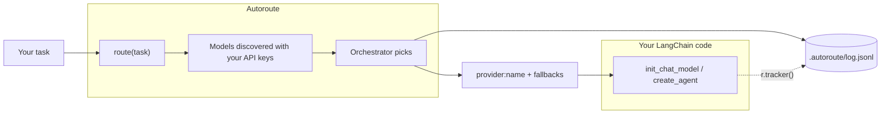

# Autoroute

🇫🇷 [Français](README.md) · 🇬🇧 **English**

**Bring your API keys. Autoroute picks the model.**

You describe a task in plain text. Autoroute picks the best LLM among the models **your API keys can access** and returns its name. You don't need to know which model to use for what.

```python
from langchain.chat_models import init_chat_model
from autoroute import route

model = init_chat_model(route("Write a Python function that parses a CSV file"))
```

Autoroute does **not** call the final model. It returns a `provider:name` string that you pass to LangChain.

## How it works



1. **Discovery**: Autoroute queries the model-listing API of every provider whose key is set, and keeps the chat models. There is no model list to maintain.
2. **Routing**: a small **orchestrator** model receives the task and that list. It returns the best model, up to 2 fallbacks, and the reason for its choice. Its answer is restricted to the discovered models.
3. **Logging**: every decision, and optionally what actually happened when the model was called, is written to a JSONL log.

## Installation

```bash
pip install git+https://github.com/SethLawson07/autoroute
```

Python 3.10 or later. LangChain and the OpenAI, Anthropic, Google GenAI and Mistral integrations are installed with it.

Already installed in your project? Recent versions are kept: Autoroute only requires minimum versions (LangChain 1.0 or later). If your project is still on LangChain 0.x, pip will upgrade it, which may change how your existing code behaves.

## Quickstart

```powershell
autoroute init                   # creates .env.example (and the optional .autoroute/config.yaml)
copy .env.example .env           # macOS / Linux: cp .env.example .env
# fill in your API keys in .env
autoroute models                 # shows where each key comes from, and the discovered models
autoroute route "Say hello in one sentence"
```

Sample output:

```
Modèle : openai:gpt-5-nano
Raison : Tâche très simple : un modèle léger et rapide suffit largement.
Replis : openai:gpt-4.1-mini, anthropic:claude-haiku-4-5-20251001
```

The CLI messages and the orchestrator's reasons are in French for now.

## Configuration

### `.env`: your API keys

One key per provider. Leave a key empty if you don't use that provider: it is skipped.

```
OPENAI_API_KEY=
ANTHROPIC_API_KEY=
GOOGLE_API_KEY=
MISTRAL_API_KEY=
```

System environment variables take precedence over `.env`. `autoroute models` shows the source of each key (`system`, `.env`, `system (.env ignored)` or `missing`), never its value.

### Modes

`AUTOROUTE_MODE` selects which providers Autoroute may route to.

| Mode | Providers | Key needed |
|---|---|---|
| `all` (default) | OpenAI, Anthropic, Gemini, Mistral | at least one |
| `openai` | OpenAI | `OPENAI_API_KEY` |
| `anthropic` | Anthropic | `ANTHROPIC_API_KEY` |
| `gemini` | Gemini | `GOOGLE_API_KEY` |
| `sovereign` | Mistral only (European provider), all models available to your key | `MISTRAL_API_KEY` |

### The orchestrator: picked automatically

The orchestrator is the model that does the routing. You don't pick it, and no model name is hard-coded: Autoroute takes it from the list of discovered models.

- It looks for a small, fast model, recognized by its family (`haiku`, `mini`, `flash`, `small`), and takes the newest. When a provider releases a new version, it is used without updating Autoroute.
- It keeps up to 2 backup orchestrators, from other providers when possible, tried if the first one doesn't answer.
- Only the mode's providers are used, so `sovereign` mode never sends your task to a non-Mistral model.

`autoroute models` shows the chosen orchestrator and the backups.

**Routing never crashes your application.** If no orchestrator answers (outage, quota), Autoroute still returns a discovered model (other than the failed orchestrators, when possible), with `routing_failed=True`, and logs the error. It only raises when it has no model to offer (no valid key).

### `.autoroute/config.yaml` (optional): forcing an orchestrator

Everything works without this file. It only replaces the automatic choice, mode by mode:

```yaml
orchestrators:
  all: anthropic:claude-sonnet-4-6
```

The forced orchestrator goes first, the automatic ones stay as backups. If it is unreachable (retired model, missing key) or the file is unreadable, Autoroute prints a warning and uses the automatic choice. `autoroute init -o provider:name` writes it for the active mode.

The choice of orchestrator matters: it only sees model **names**, so its choice depends on what it knows about them. A recent orchestrator knows recent models better.

### The `.autoroute/` folder

Autoroute keeps its files in `.autoroute/`, at the root of your project (the folder you run your application from):

```
my-project/
├── .env                 # your API keys
└── .autoroute/
    ├── config.yaml      # optional: can be committed
    ├── log.jsonl        # decision log
    └── .gitignore       # created automatically: excludes *.jsonl
```

The log contains the text of your tasks: the `.gitignore` created by Autoroute keeps it out of git.

### Environment variables

| Variable | Purpose | Default |
|---|---|---|
| `AUTOROUTE_MODE` | Routing mode | `all` |
| `AUTOROUTE_CONFIG` | Path to the config file | `.autoroute/config.yaml` |
| `AUTOROUTE_LOG` | Path to the log file | `.autoroute/log.jsonl` |

## Usage with LangChain

```python
from autoroute import route, route_candidates, route_with_reason

route("A task")                 # "anthropic:claude-sonnet-5-5"
route_candidates("A task")      # ["anthropic:claude-sonnet-5-5", "openai:gpt-5.5", ...]

r = route_with_reason("A task")
r.model                         # the chosen model
r.candidates                    # the chosen model, then up to 2 fallbacks
r.reason                        # why the orchestrator chose it
r.invalid_choice                # True if Autoroute fell back to the orchestrator
r.routing_failed                # True if no orchestrator answered
r.decision_id                   # links this decision to its log lines
r.tracker()                     # LangChain callback that records the actual outcome
```

### Chat model, with fallbacks

If the chosen model fails (rate limit, outage, no access…), LangChain moves on to the next candidate.

```python
from langchain.chat_models import init_chat_model
from autoroute import route_with_reason

task = "Write a Python function that parses a CSV file"
r = route_with_reason(task)
primary, *backups = r.candidates

model = init_chat_model(primary).with_fallbacks([init_chat_model(m) for m in backups])
print(model.invoke(task, config={"callbacks": [r.tracker()]}).content)
```

### Agent, with fallbacks

```python
from langchain.agents import create_agent
from langchain.agents.middleware import ModelFallbackMiddleware

r = route_with_reason(task)
primary, *backups = r.candidates

agent = create_agent(
    model=primary,
    tools=[...],
    middleware=[ModelFallbackMiddleware(*backups)] if backups else [],
)
agent.invoke({"messages": [{"role": "user", "content": task}]}, config={"callbacks": [r.tracker()]})
```

### The tracker

`r.tracker()` is optional. It does not call anything: it **observes** the call and logs which model actually answered, how many fallbacks were used, which attempts failed, and the tokens used. An error inside the tracker never breaks your call.

### Examples

See [`examples/`](examples):

| File | Shows |
|---|---|
| `01_chat_model.py` | Chat model with fallbacks and tracker |
| `02_agent.py` | Agent with `ModelFallbackMiddleware` and tracker |
| `03_modes.py` | Routing of simple and complex tasks |
| `04_fallback.py` | A real fallback, with a primary model forced to fail |

Autoroute returns a plain `provider:name` string. Other frameworks are not officially supported yet.

## Observability

Everything is appended to `.autoroute/log.jsonl`, one JSON object per line. There are two event types, linked by `decision_id`.

On Windows PowerShell 5.1, read it with `Get-Content .autoroute/log.jsonl -Encoding UTF8`, otherwise accents are garbled.

### `decision`: written on every routing call

```json
{"schema_version": "2", "timestamp": "2026-11-07T12:48:25+00:00", "event": "decision", "decision_id": "ae3a775c…", "task": "...", "orchestrator": "openai:gpt-4o-mini", "model": "openai:gpt-5-mini", "candidates": ["openai:gpt-5-mini", "openai:gpt-4.1-mini", "anthropic:claude-haiku-4-5-20251001"], "reason": "...", "invalid_choice": false, "routing_failed": false, "latency_ms": 2965, "mode": "all", "error": null}
```

| Field | Meaning |
|---|---|
| `model` | Chosen model |
| `candidates` | The chosen model, then up to 2 fallbacks, in order |
| `reason` | Why the orchestrator chose it |
| `invalid_choice` | `true` if the orchestrator returned no valid name: Autoroute then falls back to the orchestrator |
| `routing_failed` | `true` if no orchestrator answered: Autoroute then falls back to a discovered model |
| `latency_ms` | Routing time |
| `mode` | Mode used |
| `error` | Errors from orchestrators that didn't answer (including when a backup orchestrator took over) |

### `outcome`: written on every call to the final model, if the tracker is passed

```json
{"schema_version": "2", "timestamp": "2026-11-07T12:50:43+00:00", "event": "outcome", "decision_id": "7379aede…", "primary": "openai:gpt-5-mini", "served_by": "openai:gpt-4.1-mini", "calls": 1, "fallbacks_used": 1, "failures": [{"model": "openai:gpt-5-mini", "error": "RateLimitError: ..."}], "usage": {"input_tokens": 10, "output_tokens": 10}, "latency_ms": 1213, "error": null}
```

| Field | Meaning |
|---|---|
| `primary` | Model chosen by the orchestrator |
| `served_by` | Model that actually answered (`null` if all failed) |
| `calls` | Successful model calls (several for an agent that uses tools) |
| `fallbacks_used` | Successful calls served by a fallback |
| `failures` | Failed attempts, with model and error |
| `usage` | Tokens used (`input_tokens`, `output_tokens`) |
| `latency_ms` | Total call time, fallbacks included |
| `error` | The error your code received if every model failed |

> **The log contains the text of your tasks.** It is ignored by git. Do not share it if your tasks are sensitive.

## Known limitations

- The orchestrator is recognized by its family name (`haiku`, `mini`, `flash`, `small`): if a provider changes its naming, Autoroute takes another discovered model, possibly less suited to routing.
- The orchestrator only sees model **names**, not their capabilities or prices: it can misjudge a model it doesn't know.
- Routing is not deterministic: the same task can get different (reasonable) choices.
- Routing adds one paid call and a few seconds (about 2 to 6 s in our tests).
- One choice per task: no re-routing at each step of an agent.
- No check of the chosen model's capabilities (tool calling, vision).
- No cost calculation yet: the log records tokens, not prices.
- Only LangChain is officially supported, and the tracker only works with LangChain.

## Development

```powershell
pip install -e ".[dev]"
pytest                          # fast tests, no API calls
pytest -m live                  # real APIs (keys from .env; providers without a key are skipped)
.\scripts\qualify.ps1 -Live     # full local qualification (requires uv)
```

### Branches and pipeline

A single long-lived branch, `main`. Each change is made on a short-lived branch (`feature/…`, `fix/…`, `docs/…`) and merged into `main` through a PR.

```
main ──▶ feature/xxx ──PR (tests + qualification)──▶ main ──tag vX.Y.Z──▶ release
```

| Stage | Trigger | Checks |
|---|---|---|
| Test | push on any branch, PR to `main` | `pytest` on Linux (Python 3.10 to 3.14), Windows and macOS (3.10, 3.14), and with the minimum dependency versions |
| Qualification | PR to `main` | Package built and installed in a fresh environment, commands tested, then real APIs after approval |
| Release | `vX.Y.Z` tag on `main` | Tag = `pyproject.toml` version, GitHub Release with the wheel, then TestPyPI and PyPI (if enabled) |

`main` is protected: changes only get in through a PR whose tests and qualification are green. A push to `main` publishes nothing: only a new version (tag) is released. A released version can never be changed.

## License

[MIT](LICENSE)
