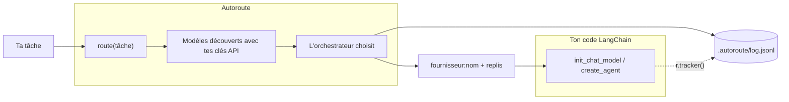

# Autoroute

🇫🇷 **Français** · 🇬🇧 [English](README.en.md)

**Apporte tes clés API. Autoroute choisit le modèle.**

Tu décris une tâche en texte libre. Autoroute choisit le meilleur LLM parmi les modèles auxquels **tes clés API donnent accès** et te renvoie son nom. Tu n'as pas à savoir quel modèle utiliser pour quoi.

```python
from langchain.chat_models import init_chat_model
from autoroute import route

model = init_chat_model(route("Écris une fonction Python qui parse un CSV"))
```

Autoroute n'appelle **pas** le modèle final. Il renvoie une chaîne `fournisseur:nom` que tu passes à LangChain.

## Comment ça marche



1. **Découverte** : Autoroute interroge l'API de liste des modèles de chaque fournisseur dont la clé est renseignée, et garde les modèles de chat. Il n'y a aucune liste de modèles à maintenir.
2. **Routage** : un petit modèle **orchestrateur** reçoit la tâche et cette liste. Il renvoie le meilleur modèle, jusqu'à 2 replis, et la raison de son choix. Sa réponse est limitée aux modèles découverts.
3. **Log** : chaque décision, et en option ce qui s'est réellement passé lors de l'appel au modèle, est écrite dans un log JSONL.

## Installation

```bash
pip install git+https://github.com/SethLawson07/autoroute
```

Python 3.10 ou plus. LangChain et les intégrations OpenAI, Anthropic, Google GenAI et Mistral sont installés avec.

## Démarrage rapide

```powershell
autoroute init                   # crée .env.example (et .autoroute/config.yaml, facultatif)
copy .env.example .env           # macOS / Linux : cp .env.example .env
# renseigne tes clés API dans .env
autoroute models                 # affiche la source de chaque clé et les modèles découverts
autoroute route "Dis bonjour en une phrase"
```

Exemple de sortie :

```
Modèle : openai:gpt-5-nano
Raison : Tâche très simple : un modèle léger et rapide suffit largement.
Replis : openai:gpt-4.1-mini, anthropic:claude-haiku-4-5-20251001
```

## Configuration

### `.env` : tes clés API

Une clé par fournisseur. Laisse une clé vide si tu n'utilises pas ce fournisseur : il est ignoré.

```
OPENAI_API_KEY=
ANTHROPIC_API_KEY=
GOOGLE_API_KEY=
MISTRAL_API_KEY=
```

Les variables d'environnement système sont prioritaires sur `.env`. `autoroute models` affiche la source de chaque clé (`system`, `.env`, `system (.env ignored)` ou `missing`), jamais sa valeur.

### Modes

`AUTOROUTE_MODE` choisit vers quels fournisseurs Autoroute peut router.

| Mode | Fournisseurs | Clé nécessaire |
|---|---|---|
| `all` (défaut) | OpenAI, Anthropic, Gemini, Mistral | au moins une |
| `openai` | OpenAI | `OPENAI_API_KEY` |
| `anthropic` | Anthropic | `ANTHROPIC_API_KEY` |
| `gemini` | Gemini | `GOOGLE_API_KEY` |
| `sovereign` | Mistral uniquement (fournisseur européen), avec tous les modèles accessibles par ta clé | `MISTRAL_API_KEY` |

### L'orchestrateur : choisi automatiquement

L'orchestrateur est le modèle qui fait le routage. Tu n'as pas à le choisir, et aucun nom de modèle n'est figé dans le code : Autoroute le prend dans la liste des modèles découverts.

- Il cherche un petit modèle rapide, reconnu à sa famille (`haiku`, `mini`, `flash`, `small`), et prend le plus récent. Quand un fournisseur sort une nouvelle version, elle est prise sans mise à jour d'Autoroute.
- Il garde jusqu'à 2 orchestrateurs de secours, si possible chez d'autres fournisseurs, essayés si le premier ne répond pas.
- Seuls les fournisseurs du mode sont utilisés : en mode `sovereign`, ta tâche n'est jamais envoyée à un modèle autre que Mistral.

`autoroute models` affiche l'orchestrateur retenu et ceux de secours.

**Le routage ne fait pas planter ton application.** Si aucun orchestrateur ne répond (panne, quota), Autoroute renvoie quand même un modèle découvert, avec `routing_failed=True`, et note l'erreur dans le log. Il ne lève une exception que s'il n'a aucun modèle à proposer (aucune clé valide).

### `.autoroute/config.yaml` (facultatif) : imposer un orchestrateur

Sans ce fichier, tout fonctionne. Il sert seulement à remplacer le choix automatique, mode par mode :

```yaml
orchestrators:
  all: anthropic:claude-sonnet-4-6
```

L'orchestrateur imposé passe en premier, les orchestrateurs automatiques restent en secours. S'il est inaccessible (modèle retiré, clé absente) ou si le fichier est illisible, Autoroute affiche un avertissement et utilise le choix automatique. `autoroute init -o fournisseur:nom` l'écrit pour le mode actif.

Le choix de l'orchestrateur compte : il ne voit que les **noms** des modèles, donc son choix dépend de ce qu'il sait d'eux. Un orchestrateur récent connaît mieux les modèles récents.

### Le dossier `.autoroute/`

Autoroute range ses fichiers dans `.autoroute/`, à la racine de ton projet (le dossier depuis lequel tu lances ton application) :

```
mon-projet/
├── .env                 # tes clés API
└── .autoroute/
    ├── config.yaml      # facultatif : peut être versionné
    ├── log.jsonl        # journal des décisions
    └── .gitignore       # créé automatiquement : exclut *.jsonl
```

Le log contient le texte de tes tâches : le `.gitignore` créé par Autoroute l'empêche de partir dans git.

### Variables d'environnement

| Variable | Rôle | Défaut |
|---|---|---|
| `AUTOROUTE_MODE` | Mode de routage | `all` |
| `AUTOROUTE_CONFIG` | Chemin du fichier de config | `.autoroute/config.yaml` |
| `AUTOROUTE_LOG` | Chemin du fichier de log | `.autoroute/log.jsonl` |

## Utilisation avec LangChain

```python
from autoroute import route, route_candidates, route_with_reason

route("Une tâche")              # "anthropic:claude-sonnet-5-5"
route_candidates("Une tâche")   # ["anthropic:claude-sonnet-5-5", "openai:gpt-5.5", ...]

r = route_with_reason("Une tâche")
r.model                         # le modèle choisi
r.candidates                    # le modèle choisi, puis jusqu'à 2 replis
r.reason                        # pourquoi l'orchestrateur l'a choisi
r.invalid_choice                # True si Autoroute s'est replié sur l'orchestrateur
r.routing_failed                # True si aucun orchestrateur n'a répondu
r.decision_id                   # relie cette décision à ses lignes de log
r.tracker()                     # callback LangChain qui enregistre le résultat réel
```

### Modèle de chat, avec replis

Si le modèle choisi échoue (rate limit, panne, pas d'accès…), LangChain passe au candidat suivant.

```python
from langchain.chat_models import init_chat_model
from autoroute import route_with_reason

task = "Écris une fonction Python qui parse un CSV"
r = route_with_reason(task)
primary, *backups = r.candidates

model = init_chat_model(primary).with_fallbacks([init_chat_model(m) for m in backups])
print(model.invoke(task, config={"callbacks": [r.tracker()]}).content)
```

### Agent, avec replis

```python
from langchain.agents import create_agent
from langchain.agents.middleware import ModelFallbackMiddleware

r = route_with_reason(task)
primary, *backups = r.candidates

agent = create_agent(
    model=primary,
    tools=[...],
    middleware=[ModelFallbackMiddleware(*backups)] if backups else [],
)
agent.invoke({"messages": [{"role": "user", "content": task}]}, config={"callbacks": [r.tracker()]})
```

### Le tracker

`r.tracker()` est optionnel. Il n'appelle rien : il **observe** l'appel et enregistre quel modèle a vraiment répondu, combien de replis ont servi, quelles tentatives ont échoué et les tokens consommés. Une erreur dans le tracker ne fait jamais échouer ton appel.

### Exemples

Voir [`examples/`](examples) :

| Fichier | Montre |
|---|---|
| `01_chat_model.py` | Modèle de chat avec replis et tracker |
| `02_agent.py` | Agent avec `ModelFallbackMiddleware` et tracker |
| `03_modes.py` | Routage de tâches simples et complexes |
| `04_fallback.py` | Un vrai repli, avec un modèle principal forcé en échec |

Autoroute renvoie une simple chaîne `fournisseur:nom`. Les autres frameworks ne sont pas encore officiellement pris en charge.

## Observabilité

Tout est ajouté à `.autoroute/log.jsonl`, un objet JSON par ligne. Il y a deux types d'événements, liés par `decision_id`.

Sous Windows PowerShell 5.1, lis-le avec `Get-Content .autoroute/log.jsonl -Encoding UTF8`, sinon les accents s'affichent mal.

### `decision` : écrite à chaque routage

```json
{"schema_version": "2", "timestamp": "2026-11-07T12:48:25+00:00", "event": "decision", "decision_id": "ae3a775c…", "task": "...", "orchestrator": "openai:gpt-4o-mini", "model": "openai:gpt-5-mini", "candidates": ["openai:gpt-5-mini", "openai:gpt-4.1-mini", "anthropic:claude-haiku-4-5-20251001"], "reason": "...", "invalid_choice": false, "routing_failed": false, "latency_ms": 2965, "mode": "all", "error": null}
```

| Champ | Signification |
|---|---|
| `model` | Modèle choisi |
| `candidates` | Le modèle choisi, puis jusqu'à 2 replis, dans l'ordre |
| `reason` | Pourquoi l'orchestrateur l'a choisi |
| `invalid_choice` | `true` si l'orchestrateur n'a renvoyé aucun nom valide : Autoroute se replie alors sur l'orchestrateur |
| `routing_failed` | `true` si aucun orchestrateur n'a répondu : Autoroute se replie alors sur un modèle découvert |
| `latency_ms` | Durée du routage |
| `mode` | Mode utilisé |
| `error` | Erreurs des orchestrateurs qui n'ont pas répondu (y compris si un orchestrateur de secours a pris le relais) |

### `outcome` : écrite à chaque appel du modèle final, si le tracker est passé

```json
{"schema_version": "2", "timestamp": "2026-11-07T12:50:43+00:00", "event": "outcome", "decision_id": "7379aede…", "primary": "openai:gpt-5-mini", "served_by": "openai:gpt-4.1-mini", "calls": 1, "fallbacks_used": 1, "failures": [{"model": "openai:gpt-5-mini", "error": "RateLimitError: ..."}], "usage": {"input_tokens": 10, "output_tokens": 10}, "latency_ms": 1213, "error": null}
```

| Champ | Signification |
|---|---|
| `primary` | Modèle choisi par l'orchestrateur |
| `served_by` | Modèle qui a réellement répondu (`null` si tous ont échoué) |
| `calls` | Appels réussis (plusieurs pour un agent qui utilise des outils) |
| `fallbacks_used` | Appels réussis servis par un repli |
| `failures` | Tentatives en échec, avec le modèle et l'erreur |
| `usage` | Tokens consommés (`input_tokens`, `output_tokens`) |
| `latency_ms` | Durée totale de l'appel, replis compris |
| `error` | L'erreur reçue par ton code si tous les modèles ont échoué |

> **Le log contient le texte de tes tâches.** Il est ignoré par git. Ne le partage pas si tes tâches sont sensibles.

## Limites connues

- L'orchestrateur est reconnu à son nom de famille (`haiku`, `mini`, `flash`, `small`) : si un fournisseur change ses noms, Autoroute prend un autre modèle découvert, peut-être moins adapté au routage.
- L'orchestrateur ne voit que les **noms** des modèles, pas leurs capacités ni leurs prix : il peut mal juger un modèle qu'il ne connaît pas.
- Le routage n'est pas déterministe : la même tâche peut recevoir des choix différents, mais raisonnables.
- Le routage ajoute un appel payant et quelques secondes (environ 2 à 6 s dans nos essais).
- Un seul choix par tâche : pas de re-routage à chaque étape d'un agent.
- Aucune vérification des capacités du modèle choisi (appel d'outils, vision).
- Pas encore de calcul de coût : le log enregistre les tokens, pas les prix.
- Seul LangChain est officiellement pris en charge, et le tracker ne fonctionne qu'avec LangChain.

## Développement

```powershell
pip install -e ".[dev]"
pytest                          # tests rapides, sans appel aux API
pytest -m live                  # vraies API (clés de .env ; fournisseur sans clé ignoré)
.\scripts\qualify.ps1 -Live     # qualification complète en local (uv requis)
```

### Branches et pipeline

Une seule branche permanente, `main`. Chaque modification se fait sur une branche courte (`feature/…`, `fix/…`, `docs/…`), fusionnée dans `main` par une PR.

```
main ──▶ feature/xxx ──PR (tests + qualification)──▶ main ──tag vX.Y.Z──▶ publication
```

| Étape | Déclencheur | Vérifications |
|---|---|---|
| Test | push sur n'importe quelle branche, PR vers `main` | `pytest` sous Linux (Python 3.10 à 3.14), Windows et macOS (3.10, 3.14), et avec les versions minimales des dépendances |
| Qualification | PR vers `main` | Paquet construit et installé dans un environnement neuf, commandes testées, puis vraies API après approbation |
| Publication | tag `vX.Y.Z` sur `main` | Tag = version de `pyproject.toml`, Release GitHub avec le wheel, puis TestPyPI et PyPI (si activé) |

`main` est protégée : on n'y entre que par une PR dont les tests et la qualification sont verts. Un push sur `main` ne publie rien : seule une nouvelle version (tag) est publiée. Une version publiée ne peut plus être modifiée.

## Licence

[MIT](LICENSE)
