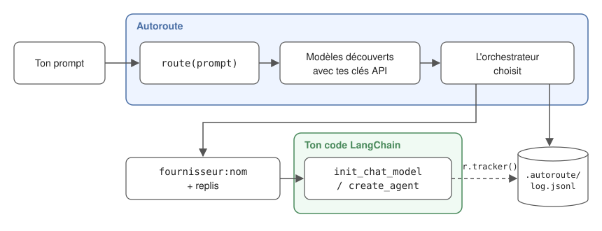

# Autoroute

🇫🇷 **Français** · 🇬🇧 [English](README.en.md)

**Apporte tes clés API. Autoroute choisit le modèle.**

Tu donnes à Autoroute ton prompt, c'est-à-dire la tâche à accomplir. Il choisit le modèle le plus adapté parmi ceux auxquels **tes clés API donnent accès**, te renvoie son nom et te dit pourquoi. Tu n'as pas à savoir quel modèle utiliser pour quoi.

```python
from langchain.chat_models import init_chat_model
from autoroute import route

prompt = "Écris une fonction Python qui parse un CSV"
model = init_chat_model(route(prompt))  # ex. "anthropic:claude-sonnet-…"
```

- **OpenAI, Anthropic, Gemini, Mistral** : les modèles sont découverts avec tes clés, sans liste à maintenir.
- **Tes clés restent chez toi** : aucun serveur Autoroute, appels directs aux fournisseurs.
- **Mode souverain** : avec `AUTOROUTE_MODE=sovereign`, seuls les modèles Mistral (France) sont utilisés. Voir [Modes](#modes).
- **Le bon prix pour chaque tâche** : un modèle léger pour les tâches simples, un modèle puissant seulement quand il le faut. La mesure du gain n'est pas encore disponible.
- **Chaque choix est expliqué** : la décision et sa raison sont écrites dans un log JSONL.
- **Ne plante jamais ton application** : orchestrateurs de secours, puis repli sur un modèle découvert.

Autoroute n'appelle **pas** le modèle : il te renvoie une chaîne `fournisseur:nom`, que tu passes à LangChain ou à un autre outil.

## Comment ça marche



1. **Découverte** : Autoroute interroge l'API de liste des modèles de chaque fournisseur dont la clé est renseignée, et garde les modèles de chat. Il n'y a aucune liste de modèles à maintenir.
2. **Routage** : un **orchestrateur**, modèle léger choisi automatiquement parmi tes modèles pour que le routage reste rapide et peu coûteux (ou celui que tu choisis dans `.autoroute/config.yaml`), reçoit ton prompt et cette liste. Il renvoie le modèle le plus adapté, jusqu'à 2 replis, et la raison de son choix. Sa réponse est limitée aux modèles découverts.
3. **Log** : chaque décision est écrite dans un log JSONL. Si tu passes `r.tracker()` à LangChain, le log indique aussi quel modèle a réellement répondu (et les éventuels replis).

## Installation

```bash
pip install autoroute-ai
```

- Avec uv : `uv add autoroute-ai`
- Version en cours de développement : `pip install git+https://github.com/SethLawson07/autoroute`

Python 3.10 ou plus. LangChain et les intégrations OpenAI, Anthropic, Google GenAI et Mistral sont installés avec Autoroute.

Déjà installés dans ton projet ? Les versions récentes sont conservées : Autoroute ne demande que des versions minimales (LangChain 1.0 ou plus). Si ton projet est encore en LangChain 0.x, pip le mettra à jour, ce qui peut changer le comportement de ton code existant. Pour éviter tout conflit, installe Autoroute dans un environnement virtuel.

## Démarrage rapide

```powershell
autoroute init                   # crée .env.example (et .autoroute/config.yaml, facultatif)
copy .env.example .env           # macOS / Linux : cp .env.example .env
# renseigne au moins une clé API dans .env (OpenAI, Anthropic, Gemini ou Mistral)
autoroute models                 # affiche la source de chaque clé et les modèles découverts
autoroute route "Conçois l'architecture d'une API de paiement sécurisée, avec gestion des remboursements"
```

Exemple de sortie :

```
Modèle : anthropic:claude-opus-5-5
Raison : Conception d'architecture complexe avec enjeux de sécurité : un modèle puissant est nécessaire.
Replis : openai:gpt-5, google_genai:gemini-3.1-pro-preview
```

Dans ton code :

```python
from autoroute import route_with_reason

r = route_with_reason("Écris une fonction Python qui parse un CSV")
print(r.model, r.reason)
```

Pour l'utiliser avec LangChain (modèle de chat, agent, replis), voir [Utilisation avec LangChain](#utilisation-avec-langchain).

## Configuration

### `.env` : tes clés API

Une clé par fournisseur. Laisse une clé vide si tu n'utilises pas ce fournisseur : il est ignoré.

```
OPENAI_API_KEY=       # OpenAI Platform
ANTHROPIC_API_KEY=    # Anthropic Console
GOOGLE_API_KEY=       # Google AI Studio (Gemini)
MISTRAL_API_KEY=      # Mistral La Plateforme
```

Les variables d'environnement système sont prioritaires sur `.env`. `autoroute models` affiche la source de chaque clé (`system`, `.env`, `system (.env ignored)` ou `missing`), jamais sa valeur.

**Tes clés restent chez toi.** Autoroute n'a pas de serveur : nous n'avons jamais accès à tes clés ni à tes prompts. Tes clés servent uniquement à appeler directement l'API de chaque fournisseur (liste des modèles, orchestrateur). Elles ne sont jamais écrites dans le log. Ton prompt n'est envoyé qu'aux fournisseurs des orchestrateurs : le principal, puis un orchestrateur de secours s'il ne répond pas. Ils appartiennent toujours au mode actif (en mode `sovereign` : Mistral uniquement).

### Modes

`AUTOROUTE_MODE` choisit vers quels fournisseurs Autoroute peut router. Pour changer de mode, ajoute par exemple `AUTOROUTE_MODE=sovereign` dans `.env` (ou en variable d'environnement).

| Mode | Fournisseurs | Clé nécessaire |
|---|---|---|
| `all` (défaut) | OpenAI, Anthropic, Gemini, Mistral | au moins une |
| `openai` | OpenAI | `OPENAI_API_KEY` |
| `anthropic` | Anthropic | `ANTHROPIC_API_KEY` |
| `gemini` | Gemini | `GOOGLE_API_KEY` |
| `sovereign` | Mistral uniquement (fournisseur français), avec tous les modèles accessibles par ta clé | `MISTRAL_API_KEY` |

Le mode s'applique aussi à l'orchestrateur : il appartient toujours à un fournisseur du mode actif.

### L'orchestrateur : choisi automatiquement

L'orchestrateur est le modèle qui fait le routage. Tu n'as pas à le choisir, et aucun nom de modèle n'est figé dans le code : Autoroute le prend dans la liste des modèles découverts.

- Il cherche un modèle léger, pour que le routage reste rapide et peu coûteux, reconnu à sa famille (`haiku`, `mini`, `flash`, `small`), et prend le plus récent. Quand un fournisseur sort une nouvelle version, elle est prise sans mise à jour d'Autoroute.
- Il garde jusqu'à 2 orchestrateurs de secours, si possible chez d'autres fournisseurs, essayés si le premier ne répond pas.
- Seuls les fournisseurs du mode sont utilisés : en mode `sovereign`, ton prompt n'est jamais envoyé à un modèle autre que Mistral.

`autoroute models` affiche l'orchestrateur retenu et ceux de secours.

**Le routage ne fait pas planter ton application.** Si aucun orchestrateur ne répond (panne, quota), Autoroute renvoie quand même un modèle découvert (autre que les orchestrateurs en échec, quand c'est possible), avec `routing_failed=True`, et note l'erreur dans le log. Il ne lève une exception que s'il n'a aucun modèle à proposer (aucune clé valide). Chaque échec d'orchestrateur, même rattrapé par un orchestrateur de secours, est signalé par un avertissement Python (`UserWarning`).

### `.autoroute/config.yaml` (facultatif) : choisir ton orchestrateur

Sans ce fichier, tout fonctionne. Il sert seulement à remplacer le choix automatique, mode par mode :

```yaml
orchestrators:
  all: anthropic:claude-haiku-5-5
```

L'orchestrateur choisi passe en premier, les orchestrateurs automatiques restent en secours. Il doit appartenir à un fournisseur du mode. S'il est inaccessible (autre fournisseur, modèle retiré, clé absente) ou si le fichier est illisible, Autoroute affiche un avertissement et utilise le choix automatique. `autoroute init -o fournisseur:nom` l'écrit pour le mode actif.

Le choix de l'orchestrateur compte : il ne voit que les **noms** des modèles, donc son choix dépend de ce qu'il sait d'eux. Un orchestrateur récent connaît mieux les modèles récents.

### Le dossier `.autoroute/`

Autoroute range ses fichiers dans `.autoroute/`, à la racine de ton projet (le dossier depuis lequel tu lances ton application) :

```
mon-projet/
├── .env                 # tes clés API
└── .autoroute/
    ├── config.yaml      # facultatif : peut être versionné
    ├── log.jsonl        # journal des décisions
    └── .gitignore       # créé automatiquement : exclut *.jsonl
```

Le log contient le texte de tes tâches : le `.gitignore` créé par Autoroute l'empêche de partir dans git.

### Variables d'environnement

Elles peuvent aussi être écrites dans `.env`.

| Variable | Rôle | Défaut |
|---|---|---|
| `AUTOROUTE_MODE` | Mode de routage | `all` |
| `AUTOROUTE_CONFIG` | Chemin du fichier de config | `.autoroute/config.yaml` |
| `AUTOROUTE_LOG` | Chemin du fichier de log | `.autoroute/log.jsonl` |

## Utilisation avec LangChain

```python
from autoroute import route, route_candidates, route_with_reason

prompt = "Écris une fonction Python qui parse un CSV"

# Choisis UNE des trois fonctions (chaque appel interroge l'orchestrateur) :
route(prompt)             # le nom du modèle : "anthropic:claude-sonnet-5-5"
route_candidates(prompt)  # le modèle, puis ses replis : ["anthropic:claude-sonnet-5-5", "openai:gpt-5.5", ...]
route_with_reason(prompt) # tout le détail, ci-dessous

r = route_with_reason(prompt)
r.model           # le modèle choisi
r.candidates      # le modèle choisi, puis jusqu'à 2 replis
r.reason          # pourquoi ce modèle
r.invalid_choice  # True si l'orchestrateur a cité un modèle inexistant : Autoroute utilise alors l'orchestrateur lui-même
r.routing_failed  # True si aucun orchestrateur n'a répondu : le modèle renvoyé n'a pas été choisi pour ta tâche
r.decision_id     # identifiant de ce routage, pour le retrouver dans le log
r.tracker()       # à passer à LangChain pour que le log note ce qui s'est vraiment passé (voir « Le tracker »)
```

### Modèle de chat, avec replis

Pour une question et une réponse : le modèle reçoit ton prompt et répond en une fois.
Si le modèle choisi échoue (rate limit, panne, pas d'accès…), LangChain passe au candidat suivant.

```python
from langchain.chat_models import init_chat_model
from autoroute import route_with_reason

prompt = "Écris une fonction Python qui parse un CSV"
r = route_with_reason(prompt)
primary, *backups = r.candidates

model = init_chat_model(primary).with_fallbacks([init_chat_model(m) for m in backups])
print(model.invoke(prompt, config={"callbacks": [r.tracker()]}).content)
```

### Agent, avec replis

Pour une tâche en plusieurs étapes : l'agent utilise des outils (fichiers, web, API…) jusqu'à pouvoir répondre. Si le modèle échoue en cours de route, l'agent passe au repli suivant.

```python
from langchain.agents import create_agent
from langchain.agents.middleware import ModelFallbackMiddleware
from autoroute import route_with_reason

prompt = "Analyse ce fichier de logs et résume les erreurs"
r = route_with_reason(prompt)
primary, *backups = r.candidates

agent = create_agent(
    model=primary,
    tools=[...],
    middleware=[ModelFallbackMiddleware(*backups)] if backups else [],
)
agent.invoke({"messages": [{"role": "user", "content": prompt}]}, config={"callbacks": [r.tracker()]})
```

### Le tracker

`r.tracker()` est optionnel. Il n'appelle rien : il **observe** l'appel et enregistre quel modèle a vraiment répondu, combien de replis ont servi, quelles tentatives ont échoué et les tokens consommés. Une erreur dans le tracker ne fait jamais échouer ton appel.

Sans tracker, le log dit ce qui a été **choisi**. Avec, il dit ce qui s'est **passé**. Par exemple : le modèle choisi était en panne, LangChain est passé au premier repli, qui a répondu en consommant 850 tokens.

Tout outil de l'écosystème LangChain qui accepte un modèle de chat (LangGraph, Deep Agents…) fonctionne de la même façon : passe-lui `init_chat_model(r.model)`, et le tracker dans `config`.

### Exemples

Voir [`examples/`](examples) :

| Fichier | Montre |
|---|---|
| `01_chat_model.py` | Modèle de chat avec replis et tracker |
| `02_agent.py` | Agent avec `ModelFallbackMiddleware` et tracker |
| `03_modes.py` | Routage de tâches simples et complexes |
| `04_fallback.py` | Un vrai repli, avec un modèle principal forcé en échec |

### Autres outils

Hors de LangChain, Autoroute te fournit déjà le fournisseur et le modèle à utiliser. La suite n'est pas encore prise en charge : choisir le bon SDK, appeler le modèle, gérer les replis. Le tracker ne fonctionne pas non plus. Pour un SDK qui n'attend que le nom du modèle (OpenAI, Anthropic…) :

```python
provider, name = route(prompt).split(":", 1)
```

## Observabilité

Le log te permet de comprendre chaque choix, de voir quand les replis servent, et de suivre les tokens consommés. Il reste sur ta machine.

Tout est ajouté à `.autoroute/log.jsonl`, un objet JSON par ligne. Il y a deux types d'événements, liés par `decision_id`. Le champ `schema_version` change si le format du log évolue : utile si tu le lis avec un script.

Sous Windows PowerShell 5.1, lis-le avec `Get-Content .autoroute/log.jsonl -Encoding UTF8`, sinon les accents s'affichent mal.

### `decision` (choix) : écrite à chaque routage

```json
{"schema_version": "2", "timestamp": "2026-11-07T12:48:25+00:00", "event": "decision", "decision_id": "ae3a775c…", "task": "Écris une fonction Python qui parse un CSV", "orchestrator": "anthropic:claude-haiku-5-5", "model": "openai:gpt-5-mini", "candidates": ["openai:gpt-5-mini", "google_genai:gemini-3.8-flash", "anthropic:claude-haiku-5-5"], "reason": "...", "invalid_choice": false, "routing_failed": false, "latency_ms": 2965, "mode": "all", "error": null}
```

| Champ | Signification |
|---|---|
| `task` | Ton prompt |
| `orchestrator` | Le modèle qui a fait le choix |
| `model` | Modèle choisi |
| `candidates` | Le modèle choisi, puis jusqu'à 2 replis, dans l'ordre |
| `reason` | Pourquoi l'orchestrateur l'a choisi |
| `invalid_choice` | `true` si l'orchestrateur a cité un modèle inexistant : Autoroute utilise alors l'orchestrateur lui-même |
| `routing_failed` | `true` si aucun orchestrateur n'a répondu : le modèle renvoyé n'a pas été choisi pour ta tâche |
| `latency_ms` | Durée du routage |
| `mode` | Mode utilisé |
| `error` | Erreurs des orchestrateurs qui n'ont pas répondu (y compris si un orchestrateur de secours a pris le relais) |

### `outcome` (résultat) : écrite à chaque appel du modèle final, si le tracker est passé

Ici, même `decision_id` que ci-dessus : le modèle choisi a atteint sa limite de requêtes, et le premier repli a répondu.

```json
{"schema_version": "2", "timestamp": "2026-11-07T12:48:31+00:00", "event": "outcome", "decision_id": "ae3a775c…", "primary": "openai:gpt-5-mini", "served_by": "google_genai:gemini-3.8-flash", "calls": 1, "fallbacks_used": 1, "failures": [{"model": "openai:gpt-5-mini", "error": "RateLimitError: ..."}], "usage": {"input_tokens": 18, "output_tokens": 420}, "latency_ms": 4213, "error": null}
```

| Champ | Signification |
|---|---|
| `primary` | Modèle choisi par l'orchestrateur |
| `served_by` | Modèle qui a réellement répondu (`null` si tous ont échoué) |
| `calls` | Appels réussis (plusieurs pour un agent qui utilise des outils) |
| `fallbacks_used` | Appels réussis servis par un repli |
| `failures` | Tentatives en échec, avec le modèle et l'erreur |
| `usage` | Tokens consommés (`input_tokens`, `output_tokens`) |
| `latency_ms` | Durée totale de l'appel, replis compris |
| `error` | L'erreur reçue par ton code si tous les modèles ont échoué |

> **Le log contient tes prompts.** Il est ignoré par git. Ne le partage pas si tes prompts sont sensibles.

## Limites connues

- L'orchestrateur est reconnu à son nom de famille (`haiku`, `mini`, `flash`, `small`) : si un fournisseur change ses noms, Autoroute prend un autre modèle découvert, peut-être moins adapté au routage.
- L'orchestrateur ne voit que les **noms** des modèles, pas leurs capacités ni leurs prix : il peut mal juger un modèle qu'il ne connaît pas.
- Le routage n'est pas déterministe : le même prompt peut recevoir des choix différents, mais raisonnables.
- Le routage ajoute un appel payant et quelques secondes (environ 1 à 7 s selon l'orchestrateur, dans nos essais).
- Pas encore de limite de temps sur l'orchestrateur : avec une clé gratuite à quota limité, le routage peut prendre plusieurs minutes.
- Chaque appel à `route()` redécouvre les modèles (un appel à l'API de liste de chaque fournisseur). Pour l'éviter, découvre une fois et réutilise la config :

  ```python
  from autoroute import route
  from autoroute.catalog import discover_config

  config = discover_config()  # une fois (respecte AUTOROUTE_MODE)
  route(prompt, config)       # ensuite, sans redécouverte
  ```

- Un fournisseur peut lister un modèle que ta clé ne peut pas appeler : s'il est choisi, les replis prennent le relais.
- Un seul choix par prompt : pas de re-routage à chaque étape d'un agent.
- Aucune vérification des capacités du modèle choisi (appel d'outils, vision).
- Pas encore de calcul de coût ni de mesure du gain : le log enregistre les tokens, pas les prix.
- Les messages de la CLI sont en français. La raison de l'orchestrateur suit la langue de ton prompt.
- Seul LangChain est officiellement pris en charge, et le tracker ne fonctionne qu'avec LangChain.

## Sécurité

Pour signaler une faille de sécurité, n'ouvre pas d'issue publique : utilise le [signalement privé de GitHub](https://github.com/SethLawson07/autoroute/security/advisories/new). Voir [SECURITY.md](SECURITY.md).

## Licence

[MIT](LICENSE) © 2026 Laté Seth Lawson-Hetchely · [sethlawson.fr](https://sethlawson.fr/)
